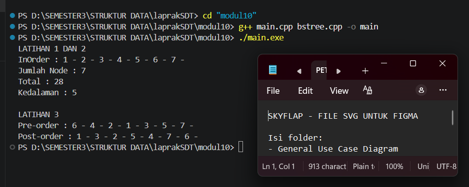

# <h1 align="center">Laporan Praktikum Modul 10 - TREE (BAGIAN PERTAMA) </h1>

<p align="center">Alma Bonita Mia Wardhana - 109082500015</p>

## Dasar Teori

Pada modul ini dibahas konsep Rekursif dan struktur data Tree, khususnya Binary Search Tree (BST). Materi yang dipelajari meliputi cara kerja fungsi rekursif, pengertian tree, aturan penyusunan data pada BST, serta operasi untuk mengelola dan menampilkan data di dalam tree.

### A. Konsep Rekursif

Rekursif merupakan proses ketika sebuah fungsi memanggil dirinya sendiri untuk menyelesaikan suatu permasalahan. Fungsi rekursif memiliki kondisi khusus untuk menghentikan proses pemanggilan agar tidak berjalan terus-menerus. Penggunaan rekursif dapat membuat penulisan program menjadi lebih sederhana, tetapi membutuhkan memori dan waktu tambahan karena fungsi harus menjalankan beberapa pemanggilan.

### B. Konsep Tree dan Binary Search Tree

Tree merupakan struktur data non-linear yang memiliki susunan data berbentuk hierarki atau bercabang. Di dalam tree terdapat beberapa istilah, seperti root sebagai node utama, parent sebagai node induk, child sebagai node anak, dan leaf sebagai node yang tidak memiliki anak. Salah satu jenis tree adalah Binary Tree, yaitu tree yang setiap node-nya memiliki maksimal dua anak, yaitu anak kiri dan anak kanan. Binary Search Tree (BST) merupakan bentuk Binary Tree yang memiliki aturan bahwa nilai lebih kecil ditempatkan di sebelah kiri, sedangkan nilai lebih besar ditempatkan di sebelah kanan.

### C. Operasi pada Binary Search Tree

Binary Search Tree memiliki beberapa operasi untuk mengelola data, seperti insert untuk menambahkan node baru, search untuk mencari data, update untuk mengubah nilai, dan delete untuk menghapus node. Selain itu, terdapat pencarian most-left untuk menemukan nilai terkecil dan most-right untuk menemukan nilai terbesar. Semua operasi tersebut dilakukan dengan tetap memperhatikan aturan penyusunan data pada BST agar struktur tree tetap teratur.

### D. Traversal dan Implementasi ADT Binary Search Tree

Traversal merupakan proses mengunjungi setiap node dalam tree untuk menampilkan data. Terdapat tiga metode traversal, yaitu PreOrder yang dimulai dari root, kemudian kiri dan kanan; InOrder yang dimulai dari kiri, root, kemudian kanan; serta PostOrder yang dimulai dari kiri, kanan, kemudian root. Dalam implementasinya, ADT Binary Search Tree menggunakan struktur Node yang terdiri dari info, left, dan right. Program dibagi menjadi file bstree.h untuk deklarasi struktur data dan fungsi, bstree.cpp untuk implementasi fungsi, serta main.cpp untuk menjalankan dan menguji program.

## Guided

### 1. bst.h

```C++
#ifndef BST_H
#define BST_H
#define Nil NULL

#include <iostream>
using namespace std;

typedef struct BST *node;

struct BST
{
    int angka;
    node left, right;
};

typedef node BinTree;

bool isEmpty(BinTree tree);
void createTree(BinTree &tree);
node alokasi(int angka);
void dealokasi(node nodeHapus);

void insertNode(BinTree &tree, node nodeBaru);
void searchByData(BinTree tree, int angka);
void preOrder(BinTree tree);
void inOrder(BinTree tree);
void postOrder(BinTree tree);

bool deleteNode(BinTree &tree, int angka);
node mostRight(BinTree tree);
node mostLeft(BinTree tree);
void deleteTree(BinTree &tree);
int size(BinTree tree);
int height(BinTree tree);
#endif
```

Pada file bst.h, dibuat struktur dasar yang digunakan dalam program Binary Search Tree (BST). Di dalamnya terdapat struct BST yang memiliki tiga bagian, yaitu angka untuk menyimpan data, left untuk menunjuk ke node sebelah kiri, dan right untuk menunjuk ke node sebelah kanan. Selain itu, terdapat deklarasi fungsi-fungsi yang akan digunakan untuk mengelola tree, seperti insert, delete, search, traversal, dan menghitung ukuran serta tinggi tree. File header ini berfungsi sebagai penghubung antara deklarasi fungsi dengan kode program yang ada di file lainnya.

### 2. bst.cpp

```C++
#include "bst.h"
#include <iostream>

using namespace std;

bool isEmpty(BinTree tree)
{
    if (tree == Nil)
    {
        return true;
    }
    else
    {
        return false;
    }
}

void createTree(BinTree &tree)
{
    tree = Nil;
}

node alokasi(int angkaInput)
{
    node nodeBaru = new BST;
    nodeBaru->angka = angkaInput;
    nodeBaru->left = Nil;
    nodeBaru->right = Nil;
    return nodeBaru;
}

void dealokasi(node nodeHapus)
{
    delete nodeHapus;
}

void insertNode(BinTree &tree, node nodeBaru)
{
    if (tree == Nil)
    {
        tree = nodeBaru;
        cout << "Node " << nodeBaru->angka << " berhasil ditambahkan ke dalam tree!" << endl;
        return;
    }
    else if (nodeBaru->angka < tree->angka)
    {
        insertNode(tree->left, nodeBaru);
    }
    else if (nodeBaru->angka > tree->angka)
    {
        insertNode(tree->right, nodeBaru);
    }
}

void searchByData(BinTree tree, int angkaCari)
{
    if (isEmpty(tree) == true)
    {
        cout << "Tree kosong!" << endl;
    }
    else
    {
        node nodeBantu = tree;
        node parent = Nil;
        bool ketemu = false;
        while (nodeBantu != Nil)
        {
            if (angkaCari < nodeBantu->angka)
            {
                parent = nodeBantu;
                nodeBantu = nodeBantu->left;
            }
            else if (angkaCari > nodeBantu->angka)
            {
                parent = nodeBantu;
                nodeBantu = nodeBantu->right;
            }
            else if (angkaCari == nodeBantu->angka)
            {
                ketemu = true;
                break;
            }
        }
        if (ketemu == false)
        {
            cout << "Data tidak ditemukan" << endl;
        }
        else if (ketemu == true)
        {
            cout << "Data ditemukan didalam tree!" << endl;
            cout << "Data Angka : " << nodeBantu->angka << endl;

            // menampilkan parentnya & pengecekan sibling
            node sibling = Nil;
            if (parent != Nil)
            {
                cout << "Parent : " << parent->angka << endl;
                if (parent->left == nodeBantu)
                {
                    sibling = parent->right;
                }
                else if (parent->right == nodeBantu)
                {
                    sibling = parent->left;
                }
            }
            else
            {
                cout << "Parent : - (node root)" << endl;
            }

            // menampilkan siblingnya
            if (sibling != Nil)
            {
                cout << "Sibling : " << sibling->angka << endl;
            }
            else
            {
                cout << "Sibling : - " << endl;
            }

            // menampilkan childnya
            if (nodeBantu->left != Nil)
            {
                cout << "Child kiri : " << nodeBantu->left->angka << endl;
            }
            else if (nodeBantu->left == Nil)
            {
                cout << "Child kiri : -" << endl;
            }
            if (nodeBantu->right != Nil)
            {
                cout << "Child kanan : " << nodeBantu->right->angka << endl;
            }
            else if (nodeBantu->right == Nil)
            {
                cout << "Child kanan : -" << endl;
            }
        }
    }
}

void preOrder(BinTree tree)
{ // tengah - kiri - kanan atau root - child kiri - child kanan
    if (tree == Nil)
    {
        return;
    }
    cout << tree->angka << " - ";
    preOrder(tree->left);
    preOrder(tree->right);
}

void inOrder(BinTree tree)
{ // kiri - tengah - kanan atau child kiri - root - child kanan
    if (tree == Nil)
    {
        return;
    }
    inOrder(tree->left);
    cout << tree->angka << " - ";
    inOrder(tree->right);
}

void postOrder(BinTree tree)
{ // kiri - kanan - tengah atau child kiri - child kanan - root
    if (tree == Nil)
    {
        return;
    }
    postOrder(tree->left);
    postOrder(tree->right);
    cout << tree->angka << " - ";
}

bool deleteNode(BinTree &tree, int angka)
{
    if (tree == Nil)
    {
        return false; // data tidak ditemukan di subtree ini
    }
    else
    {
        if (angka < tree->angka)
        {
            return deleteNode(tree->left, angka);
        }
        else if (angka > tree->angka)
        {
            return deleteNode(tree->right, angka);
        }
        else
        {
            // jika node yang mau dihapus ditemukan
            // Case 1 : node yang mau dihapus adalah leaf
            if (tree->left == Nil && tree->right == Nil)
            {
                node tmp = tree;
                tree = Nil;
                dealokasi(tmp);
            }
            // Case 2 : node yang mau dihapus hanya punya right child
            else if (tree->left == Nil)
            {
                node tmp = tree;
                tree = tree->right;
                dealokasi(tmp);
            }
            // Case 3 : node yang mau dihapus hanya punya left child
            else if (tree->right == Nil)
            {
                node tmp = tree;
                tree = tree->left;
                dealokasi(tmp);
            }
            // Case 4 : jika node yang mau dihapus punya dua child, maka ambil mostleft dari subtree kanan untuk menggantikan node yang mau dihapus
            else
            {
                // mostleft dari subtree kanan = node successor (node penerus)
                node successor = mostLeft(tree->right);
                // salin data successor ke node saat ini
                tree->angka = successor->angka;
                // hapus successor pada subtree kanan
                return deleteNode(tree->right, successor->angka);
            }
            return true; // berhasil dihapus
        }
    }
}

node mostRight(BinTree tree)
{
    while (tree->right != Nil)
    {
        tree = tree->right;
    }
    return tree;
}

node mostLeft(BinTree tree)
{
    while (tree->left != Nil)
    {
        tree = tree->left;
    }
    return tree;
}

void deleteTree(BinTree &tree)
{
    if (tree == Nil)
    {
        return;
    }
    else
    {
        deleteTree(tree->left);
        deleteTree(tree->right);
        dealokasi(tree);
        tree = Nil;
    }
}

int size(BinTree tree)
{ // mengembalikan jumlah semua node
    if (isEmpty(tree) == true)
    {
        return 0;
    }
    else
    {
        return 1 + size(tree->left) + size(tree->right);
    }
    cout << endl;
}

int height(BinTree tree)
{ // mengembalikan jumlah level tree
    if (isEmpty(tree) == true)
    {
        return -1; // tree kosong jika height = -1
    }
    else
    {
        int hl = height(tree->left);
        int hr = height(tree->right);
        int maxHeight;
        if (hl > hr)
        {
            maxHeight = hl;
        }
        else
        {
            maxHeight = hr;
        }
        return 1 + maxHeight;
    }
    cout << endl;
}
```
Pada program ini, dibuat beberapa fungsi untuk mengelola Binary Search Tree (BST), mulai dari membuat tree, menambahkan node, mencari data, menghapus node, hingga menampilkan data menggunakan traversal PreOrder, InOrder, dan PostOrder. Selain itu, terdapat fungsi untuk mencari node paling kiri (MostLeft), node paling kanan (MostRight), menghitung jumlah seluruh node (Size), serta menghitung tinggi tree (Height). Setiap fungsi memiliki tugas masing-masing untuk membantu proses pengelolaan data agar lebih teratur sesuai aturan BST, yaitu data yang lebih kecil ditempatkan di sebelah kiri dan data yang lebih besar ditempatkan di sebelah kanan.

### 3. main.cpp

```C++
#include <iostream>
#include "bst.h"

using namespace std;

int main()
{
    BinTree tree;
    createTree(tree);

    int pilih, angka;

    do
    {
        cout << "========= MENU BST =========" << endl;
        cout << "1. Insert Node" << endl;
        cout << "2. Delete Node" << endl;
        cout << "3. Search Data" << endl;
        cout << "4. Tampilkan PreOrder" << endl;
        cout << "5. Tampilkan InOrder" << endl;
        cout << "6. Tampilkan PostOrder" << endl;
        cout << "7. Size Tree (jumlah node)" << endl;
        cout << "8. Height Tree (tinggi level)" << endl;
        cout << "9. Tampilkan mostright" << endl;
        cout << "10. Tampilkan mostleft" << endl;
        cout << "11. Delete Seluruh Tree" << endl;
        cout << "0. Keluar" << endl;
        cout << "pilihan anda : ";
        cin >> pilih;
        cout << endl;

        switch (pilih)
        {
        case 1:
            cout << "Masukkan angka: ";
            cin >> angka;
            insertNode(tree, alokasi(angka));
            cout << endl;
            break;

        case 2:
            if (isEmpty(tree) == true)
            {
                cout << "Tree kosong!" << endl;
            }
            else
            {
                cout << "Masukkan angka yang ingin dihapus: ";
                cin >> angka;
                if (deleteNode(tree, angka))
                {
                    cout << "Data " << angka << " berhasil dihapus!" << endl;
                }
                else
                {
                    cout << "Data " << angka << " tidak ditemukan!" << endl;
                }
            }
            cout << endl;
            break;

        case 3:
            if (isEmpty(tree) == true)
            {
                cout << "Tree kosong!" << endl;
            }
            else
            {
                cout << "Masukkan angka yang ingin dicari: ";
                cin >> angka;
                searchByData(tree, angka);
            }
            cout << endl;
            break;

        case 4:
            if (isEmpty(tree) == true)
            {
                cout << "Tree kosong!" << endl;
            }
            else
            {
                cout << "PreOrder : ";
                preOrder(tree);
                cout << endl;
            }
            cout << endl;
            break;

        case 5:
            if (isEmpty(tree) == true)
            {
                cout << "Tree kosong!" << endl;
            }
            else
            {
                cout << "InOrder : ";
                inOrder(tree);
                cout << endl;
            }
            cout << endl;
            break;

        case 6:
            if (isEmpty(tree) == true)
            {
                cout << "Tree kosong!" << endl;
            }
            else
            {
                cout << "PostOrder : ";
                postOrder(tree);
                cout << endl;
            }
            cout << endl;
            break;

        case 7:
            cout << "Size Tree = " << size(tree) << endl;
            cout << endl;
            break;

        case 8:
            cout << "Height Tree = " << height(tree) << endl;
            cout << endl;
            break;

        case 9:
            if (isEmpty(tree) == true)
            {
                cout << "Tree kosong!" << endl;
                cout << endl;
            }
            else
            {
                cout << "Mostright : " << mostRight(tree)->angka << endl;
                cout << endl;
            }
            break;

        case 10:
            if (isEmpty(tree) == true)
            {
                cout << "Tree kosong!" << endl;
                cout << endl;
            }
            else
            {
                cout << "Mostleft : " << mostLeft(tree)->angka << endl;
                cout << endl;
            }
            break;

        case 11:
            if (isEmpty(tree) == true)
            {
                cout << "Tree kosong!" << endl;
            }
            else
            {
                deleteTree(tree);
                cout << "Seluruh tree berhasil dihapus!" << endl;
            }
            cout << endl;
            break;

        case 0:
            cout << "Keluar dari program..." << endl;
            break;

        default:
            cout << "Pilihan tidak valid!" << endl;
            break;
        }

    } while (pilih != 0);

    return 0;
}
```

Pada file main.cpp, dibuat program utama yang digunakan untuk menjalankan dan menguji seluruh fungsi Binary Search Tree (BST) melalui menu pilihan. Pengguna dapat menambahkan node, menghapus data, mencari angka, menampilkan isi tree menggunakan tiga jenis traversal, menghitung jumlah node dan tinggi tree, mencari nilai paling kecil dan paling besar, serta menghapus seluruh tree. Dengan adanya menu tersebut, pengguna dapat mencoba setiap operasi BST secara langsung dan memahami bagaimana proses pengelolaan data dalam struktur Binary Search Tree.

## Unguided

### 1. Implementasi Binary Search Tree (BST)

```C++
//bstree.cpp
#include "bstree.h"

// Membuat node baru
address alokasi(infotype x) {
    address baru = new Node;

    baru->info = x;
    baru->left = Nil;
    baru->right = Nil;

    return baru;
}

// Memasukkan data ke dalam BST
void insertNode(address &root, infotype x) {
    if (root == Nil) {
        root = alokasi(x);
    }
    else if (x < root->info) {
        insertNode(root->left, x);
    }
    else if (x > root->info) {
        insertNode(root->right, x);
    }
}

// Mencari node berdasarkan nilai
address findNode(infotype x, address root) {
    if (root == Nil || root->info == x) {
        return root;
    }

    if (x < root->info) {
        return findNode(x, root->left);
    }
    else {
        return findNode(x, root->right);
    }
}

// Menampilkan data secara Inorder
void printInorder(address root) {
    if (root != Nil) {
        printInorder(root->left);
        cout << root->info << " - ";
        printInorder(root->right);
    }
}

// Menyesuaikan nama fungsi dengan contoh main.cpp modul
void InOrder(address root) {
    printInorder(root);
}

// Menampilkan data secara Preorder
void printPreorder(address root) {
    if (root != Nil) {
        cout << root->info << " - ";
        printPreorder(root->left);
        printPreorder(root->right);
    }
}

// Menampilkan data secara Postorder
void printPostorder(address root) {
    if (root != Nil) {
        printPostorder(root->left);
        printPostorder(root->right);
        cout << root->info << " - ";
    }
}

// Menghitung jumlah node
int hitungJumlahNode(address root) {
    if (root == Nil) {
        return 0;
    }

    return 1 + hitungJumlahNode(root->left)
             + hitungJumlahNode(root->right);
}

// Menghitung total nilai seluruh node
int hitungTotalInfo(address root, int start) {
    if (root == Nil) {
        return start;
    }

    start += root->info;
    start = hitungTotalInfo(root->left, start);
    start = hitungTotalInfo(root->right, start);

    return start;
}

// Menghitung kedalaman maksimal tree
int hitungKedalaman(address root, int start) {
    if (root == Nil) {
        return start;
    }

    int kiri = hitungKedalaman(root->left, start + 1);
    int kanan = hitungKedalaman(root->right, start + 1);

    if (kiri > kanan) {
        return kiri;
    }
    else {
        return kanan;
    }
}

// Fungsi pendukung sesuai nama pada contoh modul
int hitungNode(address root) {
    return hitungJumlahNode(root);
}

int hitungTotal(address root) {
    return hitungTotalInfo(root, 0);
}
```
```C++
//bstree.h
#ifndef BSTREE_H
#define BSTREE_H

#include <iostream>
using namespace std;

#define Nil nullptr

typedef int infotype;
typedef struct Node *address;

struct Node {
    infotype info;
    address left;
    address right;
};

address alokasi(infotype x);
void insertNode(address &root, infotype x);
address findNode(infotype x, address root);

void printInorder(address root);
void InOrder(address root);
void printPreorder(address root);
void printPostorder(address root);

int hitungJumlahNode(address root);
int hitungTotalInfo(address root, int start);
int hitungKedalaman(address root, int start);

// Fungsi pendukung nama pada contoh modul
int hitungNode(address root);
int hitungTotal(address root);

#endif
```
```C++
//main.cpp
#include <iostream>
#include "bstree.h"

using namespace std;

int main() {

    // Latihan 1 dan 2
    cout << "LATIHAN 1 DAN 2" << endl;

    address root = Nil;

    insertNode(root, 1);
    insertNode(root, 2);
    insertNode(root, 6);
    insertNode(root, 4);
    insertNode(root, 5);
    insertNode(root, 3);
    insertNode(root, 6);
    insertNode(root, 7);

    cout << "InOrder : ";
    printInorder(root);

    cout << endl;
    cout << "Jumlah Node : " << hitungJumlahNode(root) << endl;
    cout << "Total : " << hitungTotalInfo(root, 0) << endl;
    cout << "Kedalaman : " << hitungKedalaman(root, 0) << endl;


    // Latihan 3
    cout << "\nLATIHAN 3" << endl;

    address root2 = Nil;

    insertNode(root2, 6);
    insertNode(root2, 4);
    insertNode(root2, 7);
    insertNode(root2, 2);
    insertNode(root2, 5);
    insertNode(root2, 1);
    insertNode(root2, 3);

    cout << "Pre-order : ";
    printPreorder(root2);

    cout << endl;

    cout << "Post-order : ";
    printPostorder(root2);

    cout << endl;

    return 0;
}
```

### Output Unguided 1 :

##### Output 1



Program ini dibuat untuk memahami penerapan struktur data Binary Search Tree menggunakan bahasa C++. Melalui program ini, kita dapat memasukkan dan mencari data, menampilkan isi tree menggunakan metode InOrder, PreOrder, dan PostOrder, serta menghitung jumlah node, total nilai, dan kedalaman maksimal tree. Penggunaan fungsi rekursif membuat proses pengolahan data pada tree menjadi lebih mudah karena setiap fungsi dapat memanggil dirinya sendiri untuk memproses bagian kiri dan kanan tree.

## Kesimpulan

Berdasarkan praktikum Modul 10 tentang Tree, dapat disimpulkan bahwa Binary Search Tree (BST) merupakan struktur data yang digunakan untuk menyimpan dan mengelola data secara bercabang dengan aturan nilai yang lebih kecil berada di sebelah kiri dan nilai yang lebih besar berada di sebelah kanan. Pada praktikum ini dipelajari cara menambahkan, mencari, dan menghapus node, menampilkan data menggunakan PreOrder, InOrder, dan PostOrder, serta menghitung jumlah node, total nilai, dan kedalaman tree. Selain itu, penggunaan fungsi rekursif membantu proses pengolahan data karena fungsi dapat memanggil dirinya sendiri untuk memeriksa bagian kiri dan kanan tree. Melalui praktikum ini, dapat dipahami bahwa BST memudahkan pengelolaan dan pencarian data agar lebih terstruktur menggunakan bahasa C++.

## Referensi

<br>[1] Triase. (2020). Diktat Edisi Revisi: Struktur Data. Medan: Universitas Islam Negeri Sumatera Utara Medan. https://repository.uinsu.ac.id/9717/2/Diktat%20Struktur%20Data.pdf

<br>[2] Budiman, & Alamsyah, N. (2023). Buku Ajar Struktur Data dan Pemrograman. Bandung: Unibi Press. Diakses melalui https://repository.unibi.ac.id/528/.

<br>[3] Budiman, Alamsyah, N., & Rasyid, A. (2023). Buku Ajar Pemrograman C++. Bandung: Unibi Press. Diakses melalui https://repository.unibi.ac.id/531/.

<br>[4] Indahyanti, U., & Rahmawati, Y. (2020). Buku Ajar Algoritma dan Pemrograman dalam Bahasa C++. Sidoarjo: Umsida Press. Diakses melalui https://doi.org/10.21070/2020/978-623-6833-67-4.