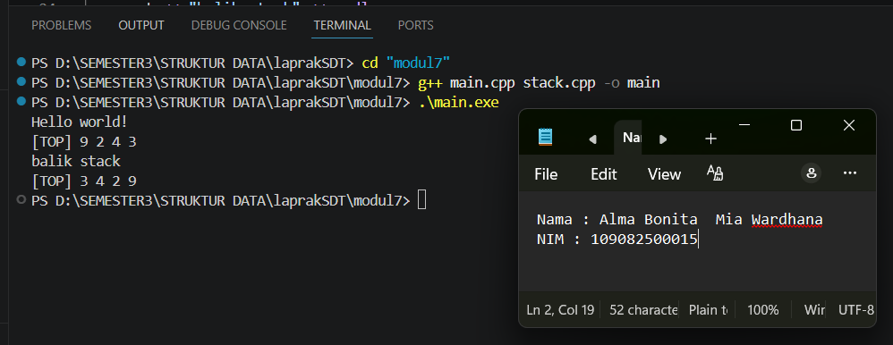
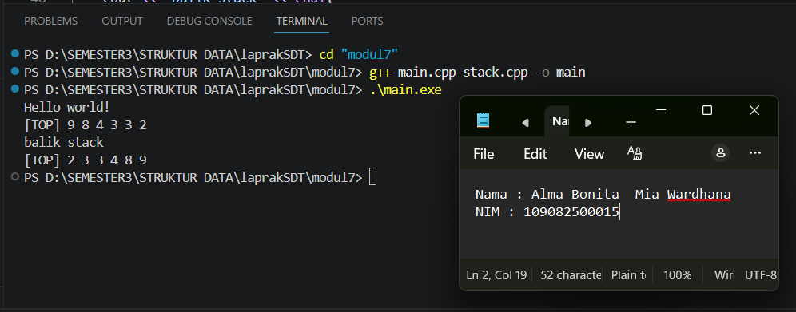
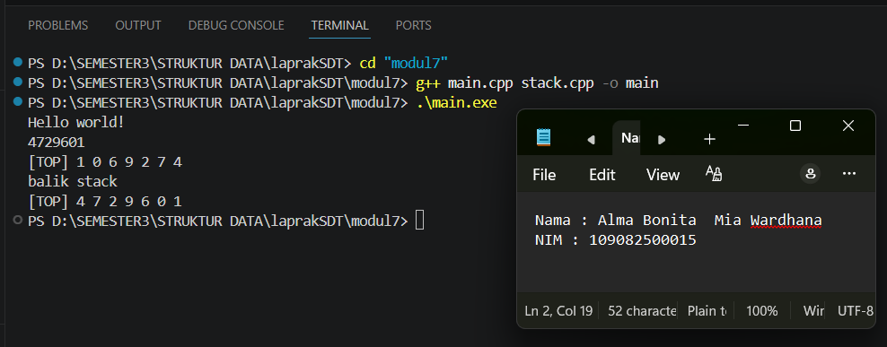

# <h1 align="center">Laporan Praktikum Modul 7 - STACK </h1>

<p align="center">Alma Bonita Mia Wardhana - 109082500015</p>

## Dasar Teori

Pada modul ini dibahas konsep Stack (tumpukan) dan operasi-operasi utama yang dapat dilakukan di dalamnya. Materi pada modul meliputi pengertian Stack, komponen-komponen penyusunnya, serta implementasi Stack menggunakan representasi pointer maupun representasi tabel (array). Stack memiliki satu titik akses utama yang disebut elemen paling awal atau "Top", yang digunakan untuk mengakses, menyisipkan, atau mengambil data di dalam tumpukan.

### A. Konsep Stack

Stack merupakan salah satu bentuk struktur data yang beroperasi dengan prinsip seperti tumpukan. Elemen yang paling atas atau yang terakhir kali masuk adalah elemen yang bisa diambil terlebih dahulu, sehingga prinsip ini biasa disebut dengan LIFO (Last In First Out). Komponen di dalam Stack pada dasarnya mirip dengan Singly linked list, namun perbedaannya terletak pada akses elemen yang hanya bisa dilakukan pada awal stack saja, yang direpresentasikan oleh "TOP".

### B. Implementasi ADT Stack
Stack dapat diimplementasikan ke dalam dua bentuk representasi, yaitu representasi pointer dan representasi tabel. Pada representasi pointer, tipe data dideklarasikan menggunakan struktur elemen (node) yang memiliki pointer next untuk saling mengaitkan data. Sementara itu, pada representasi tabel, prinsipnya menggunakan array berindeks dengan jumlah tumpukan yang terbatas. Kapasitas maksimum ditunjukkan oleh indeks Imax, dan posisi elemen teratas dilacak menggunakan pergeseran indeks TOP tanpa memerlukan manajemen memori yang rumit.

### C. Operasi Dasar dan Primitif Stack

Di dalam Stack, terdapat dua operasi utama yang digunakan untuk mengelola data, yaitu Push dan Pop. Push adalah operasi untuk menyisipkan elemen pada tumpukan data, yang cara kerjanya sama dengan fungsi insert first. Sedangkan Pop adalah operasi pengambilan elemen yang paling atas dari dalam list, yang prinsipnya mirip dengan operasi delete first. Selain itu, terdapat fungsi primitif pendukung lainnya yang digunakan untuk mengelola stack, seperti createStack() untuk pembentukan awal, isEmpty() untuk mengecek status kekosongan, fungsi pencarian, hingga operasi alokasi dan dealokasi pada representasi pointer.

## Guided

### 1. Stack.h

```C++
#ifndef STACK_TABLE
#define STACK_TABLE
#include <iostream>
using namespace std;
const int MAX = 10;

struct stackTable
{
    int data[MAX];
    int top;
};
bool isEmpty(stackTable s);
bool isFull(stackTable s);
void createStack(stackTable &s);
void push(stackTable &s, int angka);
void pop(stackTable &s);
void update(stackTable &s, int posisi);
void view(stackTable s);
void searchData(stackTable s, int data);
#endif
```

File stack.h berisi struktur data dan daftar fungsi yang digunakan dalam program Stack. Pada file ini terdapat stackTable yang memiliki array data untuk menyimpan angka dan variabel top untuk menunjukkan posisi data paling atas. Selain itu, terdapat MAX dengan nilai 10 yang berarti Stack dapat menyimpan maksimal 10 data. File ini juga berisi deklarasi fungsi seperti push, pop, update, view, dan searchData yang digunakan untuk menambah, menghapus, mengubah, menampilkan, dan mencari data.

### 2. Stack.cpp

```C++

#include "stack.h"
#include <iostream>
using namespace std;

bool isEmpty(stackTable s)
{
    return s.top == -1;
}
bool isFull(stackTable s)
{
    return s.top == MAX - 1;
}
void createStack(stackTable &s)
{
    s.top = -1;
}
void push(stackTable &s, int angka)
{

    if (isFull(s))
    {
        cout << "Stack penuh!" << endl;
    }
    else
    {
        s.top++;
        s.data[s.top] = angka;
        cout << "Data" << angka << "berhasil ditambahkan kedalam stack !" << endl;
    }
}

void pop(stackTable &s)
{
    if (isEmpty(s))
    {
        cout << "Stack kosong!" << endl;
    }
    else
    {
        int val = s.data[s.top];
        s.top--;
        cout << "Data" << val << " berhasil dihapus dari stack!" << endl;
    }
}

void update(stackTable &s, int posisi)
{
    if (isEmpty(s))
    {
        cout << "Stack kosong!" << endl;
    }
    if (posisi <= 0)
    {
        cout << "Posisi tidak valid!" << endl;
        return;
    }
    // index = top

    int idx = s.top - (posisi - 1);
    if (idx < 0 || idx > s.top)
    {
        cout << "Posisi " << posisi << " tidak valid!" << endl;
        return;
    }

    cout << "Update data posisi ke-" << posisi << endl;
    cout << "Masukkan angka : ";
    cin >> s.data[idx];
    cout << "Data berhasil diupdate!" << endl;
    cout << endl;
}

void view(stackTable s)
{
    if (isEmpty(s))
    {
        cout << "Stack kosong!" << endl;
    }
    else
    {
        for (int i = s.top; i >= 0; --i)
        {
            cout << s.data[i] << " ";
        }
    }
    cout << endl;
}

void searchData(stackTable s, int data)
{
    if (isEmpty(s))
    {
        cout << "Stack kosong!" << endl;
        return;
    }

    cout << "Mencari data " << data << "..." << endl;
    int posisi = 1;
    bool found = false;

    for (int i = s.top; i >= 0; --i)
    {
        if (s.data[i] == data)
        {
            cout << "Data " << data << " ditemukan pada posisi ke-" << posisi << endl;
            cout << endl;
            found = true;
            break;
        }
        posisi++;
    }

    if (!found)
    {
        cout << "Data " << data << " tidak ditemukan didalam stack!" << endl;
        cout << endl;
    }
}

```

File stack.cpp berisi kode untuk menjalankan fungsi-fungsi yang sudah dibuat di file stack.h. Fungsi isEmpty digunakan untuk mengecek apakah Stack kosong, sedangkan isFull untuk mengecek apakah Stack sudah penuh. Fungsi createStack digunakan untuk membuat Stack kosong, push untuk menambahkan data, dan pop untuk menghapus data paling atas. Selain itu, fungsi update digunakan untuk mengubah data sesuai posisi, view untuk menampilkan isi Stack, dan searchData untuk mencari angka yang diinginkan.

### 3. main.cpp

```C++
#include "stack.h"
#include <iostream>

using namespace std;

int main()
{
    stackTable s;
    createStack(s);

    push(s, 1);
    push(s, 2);
    push(s, 3);
    push(s, 4);
    push(s, 5);
    cout << endl;

    cout << "--- Stack setelah push ---" << endl;
    view(s);
    cout << endl;

    pop(s);
    pop(s);
    cout << endl;

    cout << "--- Stack setelah pop 2 kali ---" << endl;
    view(s);
    cout << endl;

    update(s, 2);
    update(s, 1);
    cout << endl;

    cout << "--- Stack setelah update ---" << endl;
    view(s);
    cout << endl;

    searchData(s, 4);
    searchData(s, 9);

    return 0;
}

```

File main.cpp merupakan file utama untuk menjalankan program Stack. Program dimulai dengan membuat Stack kosong, kemudian menambahkan lima angka, yaitu 1, 2, 3, 4, dan 5. Setelah itu, program menampilkan isi Stack dan menghapus dua data paling atas menggunakan fungsi pop. Selanjutnya, program mengubah data pada posisi tertentu menggunakan fungsi update, menampilkan kembali isi Stack, lalu mencari angka 4 dan 9. Dari program ini, kita dapat melihat cara kerja Stack melalui beberapa proses, mulai dari menambah, menghapus, mengubah, menampilkan, hingga mencari data.

## Guided(2)

### 1. Stack.h

```C++
#ifndef STACK
#define STACK
#define Nil nullptr

#include <iostream>
using namespace std;

typedef struct node *address;

struct node
{
    int dataAngka;
    address next;
};

struct stack
{
    address top;
};

bool isEmpty(stack listStack);
void createStack(stack &listStack);
address alokasi(int angka);
void dealokasi(address &node);

void push(stack &listStack, address nodeBaru);
void pop(stack &listStack);
void update(stack &listStack, int posisi);
void view(stack listStack);
void searchData(stack listStack, int data);

#endif
```

File stack.h berisi struktur data dan daftar fungsi yang digunakan dalam program Stack dengan Linked List. Pada file ini terdapat struktur node yang memiliki dataAngka untuk menyimpan angka dan next untuk menunjuk ke node berikutnya. Selain itu, terdapat struktur stack yang memiliki top sebagai penunjuk data paling atas. File ini juga berisi deklarasi fungsi seperti push, pop, update, view, dan searchData untuk menambah, menghapus, mengubah, menampilkan, dan mencari data di dalam Stack.

### 2. Stack.cpp

```C++
#include "stack.h"
#include <iostream>

using namespace std;

bool isEmpty(stack listStack)
{
    if (listStack.top == Nil)
    {
        return true;
    }
    else
    {
        return false;
    }
}

void createStack(stack &listStack)
{
    listStack.top = Nil;
}

address alokasi(int angka)
{
    address nodeBaru = new node;
    nodeBaru->dataAngka = angka;
    nodeBaru->next = Nil;
    return nodeBaru;
}

void dealokasi(address &node)
{
    node->next = Nil;
    delete node;
}

void push(stack &listStack, address nodeBaru)
{
    nodeBaru->next = listStack.top;
    listStack.top = nodeBaru;
    cout << "Node " << nodeBaru->dataAngka << " berhasil ditambahkan kedalam stack!" << endl;
}

void pop(stack &listStack)
{
    address nodeHapus;
    if (isEmpty(listStack) == true)
    {
        cout << "Stack kosong!" << endl;
    }
    else
    {
        nodeHapus = listStack.top;
        listStack.top = listStack.top->next;
        nodeHapus->next = Nil;
        dealokasi(nodeHapus);
        cout << "node " << nodeHapus->dataAngka << " berhasil dihapus dari stack!" << endl;
    }
}

void update(stack &listStack, int posisi)
{
    if (isEmpty(listStack) == true)
    {
        cout << "Stack kosong!" << endl;
    }
    else
    {
        if (posisi == 0)
        {
            cout << "Posisi tidak valid!" << endl;
        }
        else
        {
            address nodeBantu = listStack.top;
            int count = 1;
            bool found = false;
            while (nodeBantu != Nil)
            {
                if (count < posisi)
                {
                    nodeBantu = nodeBantu->next;
                    count++;
                }
                else if (count == posisi)
                {
                    cout << "Update node poisisi ke-" << posisi << endl;
                    cout << "Masukkan angka : ";
                    cin >> nodeBantu->dataAngka;
                    cout << "Data berhasil diupdate!" << endl;
                    cout << endl;
                    found = true;
                    break;
                }
            }
            if (found == false)
            {
                cout << "Posisi " << posisi << " tidak valid!" << endl;
            }
        }
    }
}

void view(stack listStack)
{
    if (isEmpty(listStack) == true)
    {
        cout << "List kosong!" << endl;
    }
    else
    {
        address nodeBantu = listStack.top;
        while (nodeBantu != Nil)
        {
            cout << nodeBantu->dataAngka << " ";
            nodeBantu = nodeBantu->next;
        }
    }
    cout << endl;
}

void searchData(stack listStack, int data)
{
    if (isEmpty(listStack) == true)
    {
        cout << "List kosong!" << endl;
    }
    else
    {
        address nodeBantu = listStack.top;
        int posisi = 1;
        bool found = false;
        cout << "Mencari data " << data << "..." << endl;
        while (nodeBantu != Nil)
        {
            if (nodeBantu->dataAngka == data)
            {
                cout << "Data " << data << " ditemukan pada posisi ke-" << posisi << endl;
                found = true;
                cout << endl;
                break;
            }
            else
            {
                posisi++;
                nodeBantu = nodeBantu->next;
            }
        }
        if (found == false)
        {
            cout << "Data " << data << " tidak ditemukan didalam stack!" << endl;
            cout << endl;
        }
    }
}
```

File stack.cpp berisi kode untuk menjalankan fungsi-fungsi yang sudah dibuat di file stack.h. Fungsi isEmpty digunakan untuk mengecek apakah Stack kosong, sedangkan createStack digunakan untuk membuat Stack dalam keadaan kosong. Fungsi alokasi digunakan untuk membuat node baru dan menyimpan angka, sedangkan dealokasi digunakan untuk menghapus node dari memori. Selanjutnya, fungsi push digunakan untuk menambahkan data ke bagian paling atas Stack, pop untuk menghapus data paling atas, update untuk mengubah data sesuai posisi, view untuk menampilkan seluruh isi Stack, dan searchData untuk mencari angka tertentu.

### 3. main.cpp

```C++
#include "stack.h"
#include <iostream>

using namespace std;

int main()
{
    stack listStack;
    address nodeA, nodeB, nodeC, nodeD, nodeE = Nil;
    createStack(listStack);

    nodeA = alokasi(1);
    nodeB = alokasi(2);
    nodeC = alokasi(3);
    nodeD = alokasi(4);
    nodeE = alokasi(5);

    push(listStack, nodeA);
    push(listStack, nodeB);
    push(listStack, nodeC);
    push(listStack, nodeD);
    push(listStack, nodeE);
    cout << endl;

    cout << "--- Stack setelah push ---" << endl;
    view(listStack);
    cout << endl;

    pop(listStack);
    pop(listStack);
    cout << endl;

    cout << "--- Stack setelah pop 2 kali ---" << endl;
    view(listStack);
    cout << endl;

    update(listStack, 2);
    update(listStack, 1);
    update(listStack, 4);
    cout << endl;

    cout << "--- Stack setelah update ---" << endl;
    view(listStack);
    cout << endl;

    searchData(listStack, 4);
    searchData(listStack, 9);

    return 0;
}
```

File main.cpp merupakan file utama yang digunakan untuk menjalankan dan mencoba semua fungsi Stack. Program dimulai dengan membuat Stack kosong, kemudian membuat lima node yang berisi angka 1 sampai 5 menggunakan fungsi alokasi. Setelah itu, semua node dimasukkan ke dalam Stack menggunakan fungsi push. Program kemudian menampilkan isi Stack, menghapus dua data paling atas menggunakan pop, dan mengubah data pada posisi tertentu menggunakan update. Terakhir, program menampilkan kembali isi Stack dan mencari angka 4 dan 9 menggunakan searchData untuk mengetahui apakah angka tersebut ada di dalam Stack.

## Unguided

### 1. Latihan ADT Doubly Linked List Pengelolaan Data Kendaraan

```C++
//stack.cpp
#include <iostream>
#include "stack.h"

using namespace std;

void createStack(Stack &S) {
    S.top = -1; // Index -1 digunakan untuk merepresentasikan stack kosong dalam array C++
}

void push(Stack &S, infotype x) {
    if (S.top < 19) {
        S.top++;
        S.info[S.top] = x;
    } else {
        cout << "Stack Penuh!" << endl;
    }
}

infotype pop(Stack &S) {
    infotype temp = 0;
    if (S.top != -1) {
        temp = S.info[S.top];
        S.top--;
    }
    return temp;
}

void printInfo(Stack S) {
    cout << "[TOP] ";
    for (int i = S.top; i >= 0; i--) {
        cout << S.info[i] << " ";
    }
    cout << endl;
}

void balikStack(Stack &S) {
    Stack temp1, temp2;
    createStack(temp1);
    createStack(temp2);

    while (S.top != -1) {
        push(temp1, pop(S));
    }
    while (temp1.top != -1) {
        push(temp2, pop(temp1));
    }
    while (temp2.top != -1) {
        push(S, pop(temp2));
    }
}

void pushAscending(Stack &S, infotype x) {
    Stack temp;
    createStack(temp);

    while (S.top != -1 && S.info[S.top] > x) {
        push(temp, pop(S));
    }
    
    push(S, x);
    
    while (temp.top != -1) {
        push(S, pop(temp));
    }
}

void getInputStream(Stack &S) {
    char c;
    while ((c = cin.get()) != '\n') {
        if (c >= '0' && c <= '9') {
            push(S, c - '0'); 
        }
    }
}
```
```C++
//stack.h
#ifndef STACK_H
#define STACK_H

typedef int infotype;

struct Stack {
    infotype info[20];
    int top;
};

void createStack(Stack &S);
void push(Stack &S, infotype x);
infotype pop(Stack &S);
void printInfo(Stack S);
void balikStack(Stack &S);
void pushAscending(Stack &S, infotype x);
void getInputStream(Stack &S);

#endif
```
```C++
//main.cpp
#include <iostream>
#include "stack.h"

using namespace std;

// ==========================================
// LATIHAN 1: Implementasi Dasar & balikStack
// ==========================================
int main() {
    cout << "Hello world!" << endl;
    Stack S;
    createStack(S);
    
    push(S, 3);
    push(S, 4);
    push(S, 8);
    pop(S);
    push(S, 2);
    push(S, 3);
    pop(S);
    push(S, 9);
    
    printInfo(S);
    cout << "balik stack" << endl;
    balikStack(S);
    printInfo(S);
    
    return 0;
}

// ==========================================
// LATIHAN 2: pushAscending
// ==========================================

int main() {
    cout << "Hello world!" << endl;
    Stack S;
    createStack(S);
    
    pushAscending(S, 3);
    pushAscending(S, 4);
    pushAscending(S, 8);
    pushAscending(S, 2);
    pushAscending(S, 3);
    pushAscending(S, 9);
    
    printInfo(S);
    cout << "balik stack" << endl;
    balikStack(S);
    printInfo(S);
    
    return 0;
}

// ==========================================
// LATIHAN 3: getInputStream
// ==========================================

int main() {
    cout << "Hello world!" << endl;
    Stack S;
    createStack(S);
    
    getInputStream(S); // Masukkan input secara berderet, contoh: 4729601
    
    printInfo(S);
    cout << "balik stack" << endl;
    balikStack(S);
    printInfo(S);
    
    return 0;
}
```

### Output Unguided 1 :

##### Output 1



##### Output 2



##### Output 3



Program tersebut merupakan implementasi struktur data Stack (tumpukan) berbasis array dalam bahasa C++ yang bekerja dengan prinsip LIFO (Last In First Out), mencakup operasi dasar manipulasi memori statis (push dan pop) serta tiga fungsionalitas pengembangan yang lebih kompleks. Secara keseluruhan, program ini mendemonstrasikan fleksibilitas pengelolaan tumpukan data melalui kemampuan membalikkan urutan elemen secara utuh menggunakan bantuan stack sementara (balikStack), menyisipkan elemen baru secara otomatis ke posisi yang terurut atau ascending (pushAscending), serta menangkap dan mengonversi masukan deret karakter angka secara dinamis dari pengguna (getInputStream), sehingga memberikan pemahaman komprehensif mengenai manipulasi urutan data sekuensial.

## Kesimpulan

Berdasarkan praktikum Modul 7, dapat disimpulkan bahwa Stack merupakan struktur data yang menggunakan prinsip LIFO (Last In First Out), yaitu data yang terakhir masuk akan menjadi data pertama yang keluar. Pada praktikum ini dipelajari cara membuat Stack menggunakan dua bentuk, yaitu array dan Linked List, serta memahami fungsi-fungsi seperti push untuk menambahkan data, pop untuk menghapus data paling atas, update untuk mengubah data, view untuk menampilkan data, dan search untuk mencari data. Selain itu, melalui latihan yang diberikan, dipelajari juga cara membalik urutan Stack, memasukkan data secara berurutan (ascending), dan membaca input angka dari pengguna. Dengan praktikum ini, dapat dipahami bagaimana Stack bekerja dan bagaimana cara mengelola data menggunakan bahasa C++.

## Referensi

<br>[1] Triase. (2020). Diktat Edisi Revisi: Struktur Data. Medan: Universitas Islam Negeri Sumatera Utara Medan. https://repository.uinsu.ac.id/9717/2/Diktat%20Struktur%20Data.pdf

<br>[2] Budiman, & Alamsyah, N. (2023). Buku Ajar Struktur Data dan Pemrograman. Bandung: Unibi Press. Diakses melalui https://repository.unibi.ac.id/528/.

<br>[3] Budiman, Alamsyah, N., & Rasyid, A. (2023). Buku Ajar Pemrograman C++. Bandung: Unibi Press. Diakses melalui https://repository.unibi.ac.id/531/.

<br>[4] Indahyanti, U., & Rahmawati, Y. (2020). Buku Ajar Algoritma dan Pemrograman dalam Bahasa C++. Sidoarjo: Umsida Press. Diakses melalui https://doi.org/10.21070/2020/978-623-6833-67-4.