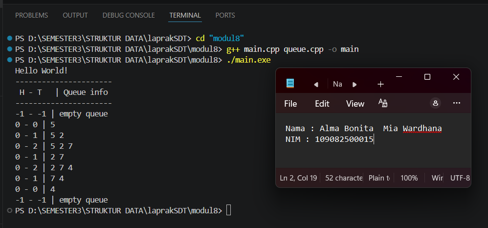
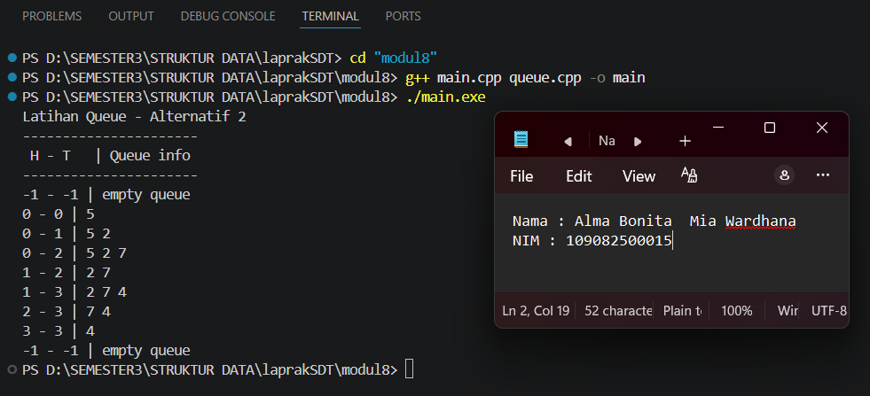
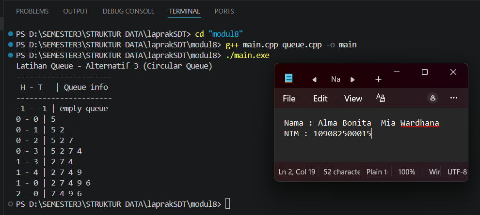

# <h1 align="center">Laporan Praktikum Modul 8 - QUEUE </h1>

<p align="center">Alma Bonita Mia Wardhana - 109082500015</p>

### Dasar Teori
Pada modul ini dibahas konsep Queue dan beberapa operasi yang dapat dilakukan pada antrean. Materi pada modul meliputi pengertian Queue, prinsip FIFO, penggunaan pointer dan array, serta operasi untuk menambahkan, menghapus, dan menampilkan elemen dalam antrean. Queue merupakan struktur data yang menggunakan prinsip FIFO (First In, First Out), yaitu data yang pertama kali masuk akan menjadi data yang pertama kali keluar.

### A. Konsep Queue
Queue merupakan struktur data yang dapat diumpamakan seperti sebuah antrean. Dalam Queue, proses penambahan data dilakukan pada bagian belakang antrean (tail), sedangkan penghapusan data dilakukan pada bagian depan antrean (head). Queue dapat diimplementasikan menggunakan array maupun linked list. Pada representasi array, data disimpan dalam indeks tertentu, sedangkan pada linked list, setiap elemen dihubungkan menggunakan pointer.

### B. Implementasi ADT Queue
ADT Queue digunakan untuk mengatur struktur data dan operasi yang terdapat dalam antrean. Pada implementasi Queue menggunakan array, terdapat tipe data infotype untuk menyimpan data bertipe integer dan struktur Queue yang memiliki array info dengan kapasitas 5 elemen serta variabel head dan tail untuk menunjukkan posisi awal dan akhir antrean. Selain itu, terdapat beberapa prototype fungsi yang digunakan untuk mengelola Queue, seperti createQueue, isEmptyQueue, isFullQueue, enqueue, dequeue, dan printInfo.

### C. Operasi Dasar Queue
Operasi dasar pada Queue digunakan untuk mengelola data yang ada di dalam antrean. Beberapa operasi yang digunakan yaitu createQueue untuk membuat antrean kosong, isEmptyQueue untuk memeriksa apakah antrean kosong, dan isFullQueue untuk memeriksa apakah antrean penuh. Selain itu, terdapat enqueue untuk menambahkan data ke bagian belakang antrean, dequeue untuk menghapus data paling depan, serta printInfo untuk menampilkan isi antrean beserta posisi head dan tail. Semua operasi tersebut mengikuti prinsip FIFO, sehingga urutan data yang masuk tetap terjaga.

### D. Penerapan ADT Queue pada Program
ADT Queue diterapkan dengan membuat deklarasi struktur data dan prototype fungsi pada file queue.h, kemudian implementasi fungsi dibuat pada file queue.cpp. Program utama pada main.cpp digunakan untuk membuat Queue, melakukan penambahan dan penghapusan data, serta menampilkan isi antrean menggunakan printInfo. Pada latihan modul 8.5, Queue menggunakan array dengan kapasitas 5 elemen dan dikembangkan menjadi tiga alternatif, yaitu Alternatif 1 dengan posisi head diam dan tail bergerak, Alternatif 2 dengan head dan tail bergerak, serta Alternatif 3 dengan head dan tail berputar atau dikenal sebagai Circular Queue. Ketiga alternatif tersebut memiliki cara kerja yang berbeda dalam mengatur posisi indeks, tetapi tetap menggunakan prinsip FIFO.

## Guided

### 1. queue.h

```C++
#ifndef QUEUE_H
#define QUEUE_H

#include <iostream>
#include <string>
using namespace std;

struct Node
{
    string nama;
    Node *next;
};

struct queue
{
    Node *head, *tail;
};

void CreateQueue(queue &Q);
bool isEmpty(queue Q);
void enQueue(queue &Q, const string &nama);
void deQueue(queue &Q);
void viewQueue(queue Q);
void clearQueue(queue &Q);
#endif
```

File queue.h berisi deklarasi struktur data dan fungsi yang digunakan dalam program Queue. Di dalamnya terdapat struct Node untuk menyimpan data nama dan pointer next, serta struct queue yang memiliki pointer head dan tail untuk mengatur antrian. Selain itu, terdapat deklarasi beberapa fungsi seperti CreateQueue, isEmpty, enQueue, deQueue, viewQueue, dan clearQueue yang akan digunakan untuk mengelola data dalam Queue.

### 2. queue.cpp

```C++
#include "queue.h"

void CreateQueue(queue &Q)
{
    Q.head = Q.tail = nullptr;
}

bool isEmpty(queue Q)
{
    return Q.head == nullptr && Q.tail == nullptr;
}

bool isFull(queue Q)
{
    int maxQueue = 20;
    int counter = 0;
    Node *nodeBantu = Q.head;

    while (nodeBantu != Q.tail)
    {
        counter++;
        nodeBantu -> next;
    }

    return counter >= maxQueue;
}

void enQueue(queue &Q, const string &nama)
{
    if (isEmpty(Q)) 
    {
        Node *nodeBaru = new Node{nama, nullptr};
        Q.head = Q.tail = nodeBaru;
    } 
    else 
    {
        Node *nodeBaru = new Node{nama, nullptr};
        Q.tail -> next = nodeBaru;
        Q.tail = nodeBaru;
    }
}

void deQueue(queue &Q)
{
    if (isEmpty(Q)) 
    {
        cout << "Queue kosong";
    }
    else
    {
        Node *nodeHapus = Q.head;
        Q.head = Q.head -> next;
        delete nodeHapus;
    }
}

void viewQueue(queue Q)
{
    if (isEmpty(Q))
    {
        cout << "Queue kosong";
    }
    else
    {
        Node *nodeBantu = Q.head;

        while (nodeBantu != nullptr)
        {
            cout << "Nama : " << nodeBantu -> nama << endl;
            nodeBantu = nodeBantu -> next;
        }
    }
}

void clearQueue(queue &Q)
{
    if (isEmpty(Q))
    {
        cout << "Queue kosong";
    }
    else
    {
        Node *nodeHapus = Q.head;

        while (nodeHapus != nullptr)
        {
            nodeHapus = nodeHapus -> next;
            deQueue(Q);
        }
    }
}
```

File queue.cpp berisi implementasi dari fungsi-fungsi yang telah dideklarasikan pada queue.h. Fungsi-fungsi tersebut digunakan untuk membuat queue kosong, memeriksa kondisi queue, menambahkan data, menghapus data dari antrian, menampilkan seluruh data, dan menghapus semua isi queue. Pada program ini, proses antrian menggunakan prinsip FIFO (First In, First Out), sehingga data yang pertama masuk akan menjadi data yang pertama keluar.

### 3. main.cpp

```C++
#include "queue.h"
#include <iostream>
using namespace std;

int main()
{
    queue Q;
    CreateQueue(Q);

    enQueue(Q, "Gilar");
    enQueue(Q, "Aflah");
    enQueue(Q, "Aedil");
    enQueue(Q, "Fathir");
    enQueue(Q, "Kevin");
    enQueue(Q, "Zulfa");
    cout << endl;

    cout << "--- Isi Queue Setelah enqueue ---" << endl;
    viewQueue(Q);        

    deQueue(Q);
    deQueue(Q);
    deQueue(Q);
    deQueue(Q);
    cout << endl;

    cout << "--- Isi Queue Setelah dequeue ---" << endl;
    viewQueue(Q);

    clearQueue(Q);
    return 0;
}
```

File main.cpp merupakan bagian utama untuk menjalankan dan menguji program Queue. Pada file ini dilakukan pembuatan queue, penambahan beberapa nama menggunakan fungsi enQueue, penampilan data menggunakan viewQueue, serta penghapusan beberapa data menggunakan deQueue. Setelah itu, fungsi clearQueue digunakan untuk menghapus seluruh data yang tersisa. Melalui program ini, kita dapat melihat secara langsung bagaimana proses penambahan dan penghapusan data dalam struktur Queue menggunakan Linked List.

## Guided 2

### 1. queue.h

```C++  
#ifndef QUEUE_H
#define QUEUE_H

#include <iostream>
using namespace std;

const int MAKSIMAL = 5;

struct queue
{
    string nama[MAKSIMAL];
    int head;
    int tail;
};

bool isFull(queue Q);
bool isEmpty(queue Q);
void CreateQueue(queue &Q);
void enQueue(queue &Q, string nama);
void deQueue(queue &Q);
void viewQueue(queue Q);

#endif
```

File queue.h berisi deklarasi struktur data Queue menggunakan Array dengan kapasitas maksimal 5 data. Di dalamnya terdapat variabel nama untuk menyimpan nama, serta head dan tail untuk menunjukkan posisi awal dan akhir antrian. Selain itu, terdapat deklarasi fungsi seperti isFull, isEmpty, CreateQueue, enQueue, deQueue, dan viewQueue yang digunakan untuk mengelola data dalam Queue.

### 2. queue.cpp

```C++
#ifndef QUEUE_H
#define QUEUE_H

#include <iostream>
using namespace std;

const int MAKSIMAL = 5;

struct queue
{
    string nama[MAKSIMAL];
    int head;
    int tail;
};

bool isFull(queue Q);
bool isEmpty(queue Q);
void CreateQueue(queue &Q);
void enQueue(queue &Q, string nama);
void deQueue(queue &Q);
void viewQueue(queue Q);

#endif
```

File queue.cpp berisi implementasi fungsi-fungsi Queue menggunakan Array dengan prinsip FIFO (First In, First Out), yaitu data yang pertama masuk akan menjadi data pertama yang keluar. Pada implementasi ini, digunakan Queue Linear dengan kapasitas maksimal 5 data. Proses penambahan dilakukan menggunakan enQueue, sedangkan penghapusan dilakukan menggunakan deQueue dengan menggeser data setelah elemen pertama dihapus. Selain itu, terdapat fungsi untuk memeriksa apakah Queue penuh atau kosong serta menampilkan seluruh data yang tersimpan.

### 3. main.cpp

```C++
#include "queue.h"
#include <iostream>

using namespace std;

int main(){
    queue Q;

    CreateQueue(Q);
    enQueue(Q, "Dimas");
    enQueue(Q, "Arvin");
    enQueue(Q, "Rizal");
    enQueue(Q, "Hafizh");
    enQueue(Q, "Fathur");
    enQueue(Q, "Daffa");
    cout << endl;

    cout << "--- Isi Queue Setelah enQueue ---" << endl;
    viewQueue(Q);
    cout << endl;

    deQueue(Q);
    deQueue(Q);
    deQueue(Q);
    deQueue(Q);
    // deQueue(Q);
    // deQueue(Q);
    cout << endl;

    cout << "--- Isi Queue Setelah deQueue ---" << endl;
    viewQueue(Q);

    return 0;
}
```

File main.cpp merupakan program utama yang digunakan untuk menjalankan dan menguji fungsi Queue. Pada program ini dilakukan pembuatan Queue kosong, kemudian menambahkan beberapa nama menggunakan enQueue, menampilkan isi antrian menggunakan viewQueue, dan menghapus beberapa data menggunakan deQueue. Dari hasil program tersebut dapat diketahui bahwa Queue memiliki batas penyimpanan sebanyak 5 data dan data yang pertama masuk akan dihapus terlebih dahulu sesuai dengan prinsip FIFO.

## Unguided

### 1. Implementasi Abstract Data Type (ADT) Queue Menggunakan Array

```C++
//queue.cpp
// #include "queue.h"
// #include <iostream>
// using namespace std;

// void createQueue(Queue &Q) {
//     Q.head = -1;
//     Q.tail = -1;
// }

// bool isEmptyQueue(const Queue &Q) {
//     return Q.head == -1;
// }

// bool isFullQueue(const Queue &Q) {
//     return Q.tail == MAX_QUEUE - 1;
// }

// void enqueue(Queue &Q, infotype x) {
//     if (isFullQueue(Q)) {
//         cout << "Queue penuh" << endl;
//         return;
//     }

//     if (isEmptyQueue(Q)) {
//         Q.head = 0;
//     }

//     Q.tail++;
//     Q.info[Q.tail] = x;
// }

// infotype dequeue(Queue &Q) {
//     if (isEmptyQueue(Q)) {
//         cout << "Queue kosong" << endl;
//         return -1;
//     }

//     infotype x = Q.info[Q.head];

//     for (int i = Q.head; i < Q.tail; i++) {
//         Q.info[i] = Q.info[i + 1];
//     }

//     Q.tail--;

//     if (Q.tail < Q.head) {
//         Q.head = -1;
//         Q.tail = -1;
//     }

//     return x;
// }

// void printInfo(const Queue &Q) {
//     cout << Q.head << " - " << Q.tail << " | ";

//     if (isEmptyQueue(Q)) {
//         cout << "empty queue";
//     } else {
//         for (int i = Q.head; i <= Q.tail; i++) {
//             cout << Q.info[i] << " ";
//         }
//     }

//     cout << endl;
// }


//ALTERNATIF 2
// #include "queue.h"
// #include <iostream>
// using namespace std;

// void createQueue(Queue &Q) {
//     Q.head = -1;
//     Q.tail = -1;
// }

// bool isEmptyQueue(const Queue &Q) {
//     return Q.head == -1;
// }

// bool isFullQueue(const Queue &Q) {
//     if (isEmptyQueue(Q)) {
//         return false;
//     }

//     return (Q.tail - Q.head + 1) == MAX_QUEUE;
// }

// void enqueue(Queue &Q, infotype x) {
//     if (isFullQueue(Q)) {
//         cout << "Queue penuh" << endl;
//         return;
//     }

//     if (isEmptyQueue(Q)) {
//         Q.head = 0;
//         Q.tail = 0;
//     } else {
//         if (Q.tail == MAX_QUEUE - 1) {
//             int jumlah = 0;

//             for (int i = Q.head; i <= Q.tail; i++) {
//                 Q.info[jumlah] = Q.info[i];
//                 jumlah++;
//             }

//             Q.head = 0;
//             Q.tail = jumlah - 1;
//         }

//         Q.tail++;
//     }

//     Q.info[Q.tail] = x;
// }

// infotype dequeue(Queue &Q) {
//     if (isEmptyQueue(Q)) {
//         cout << "Queue kosong" << endl;
//         return -1;
//     }

//     infotype x = Q.info[Q.head];

//     if (Q.head == Q.tail) {
//         Q.head = -1;
//         Q.tail = -1;
//     } else {
//         Q.head++;
//     }

//     return x;
// }

// void printInfo(const Queue &Q) {
//     cout << Q.head << " - " << Q.tail << " | ";

//     if (isEmptyQueue(Q)) {
//         cout << "empty queue";
//     } else {
//         for (int i = Q.head; i <= Q.tail; i++) {
//             cout << Q.info[i] << " ";
//         }
//     }

//     cout << endl;
// }


//ALTERNATIF 3
#include "queue.h"
#include <iostream>
using namespace std;

void createQueue(Queue &Q) {
    Q.head = -1;
    Q.tail = -1;
}

bool isEmptyQueue(const Queue &Q) {
    return Q.head == -1;
}

bool isFullQueue(const Queue &Q) {
    if (isEmptyQueue(Q)) {
        return false;
    }

    return (Q.tail + 1) % MAX_QUEUE == Q.head;
}

void enqueue(Queue &Q, infotype x) {
    if (isFullQueue(Q)) {
        cout << "Queue penuh" << endl;
        return;
    }

    if (isEmptyQueue(Q)) {
        Q.head = 0;
        Q.tail = 0;
    } else {
        Q.tail = (Q.tail + 1) % MAX_QUEUE;
    }

    Q.info[Q.tail] = x;
}

infotype dequeue(Queue &Q) {
    if (isEmptyQueue(Q)) {
        cout << "Queue kosong" << endl;
        return -1;
    }

    infotype x = Q.info[Q.head];

    if (Q.head == Q.tail) {
        Q.head = -1;
        Q.tail = -1;
    } else {
        Q.head = (Q.head + 1) % MAX_QUEUE;
    }

    return x;
}

void printInfo(const Queue &Q) {
    cout << Q.head << " - " << Q.tail << " | ";

    if (isEmptyQueue(Q)) {
        cout << "empty queue";
    } else {
        int i = Q.head;

        while (true) {
            cout << Q.info[i] << " ";

            if (i == Q.tail) {
                break;
            }

            i = (i + 1) % MAX_QUEUE;
        }
    }

    cout << endl;
}
```
```C++
//queue.h
#ifndef QUEUE_H
#define QUEUE_H

const int MAX_QUEUE = 5;
typedef int infotype;

struct Queue {
    infotype info[MAX_QUEUE];
    int head;
    int tail;
};

void createQueue(Queue &Q);
bool isEmptyQueue(const Queue &Q);
bool isFullQueue(const Queue &Q);
void enqueue(Queue &Q, infotype x);
infotype dequeue(Queue &Q);
void printInfo(const Queue &Q);

#endif
```
```C++
//main.cpp
// #include <iostream>
// #include "queue.h"
// using namespace std;

// int main() {
//     cout << "Hello World!" << endl;

//     Queue Q;
//     createQueue(Q);

//     cout << "----------------------" << endl;
//     cout << " H - T \t | Queue info" << endl;
//     cout << "----------------------" << endl;
//     printInfo(Q);

//     enqueue(Q, 5); printInfo(Q);
//     enqueue(Q, 2); printInfo(Q);
//     enqueue(Q, 7); printInfo(Q);
//     dequeue(Q); printInfo(Q);
//     enqueue(Q, 4); printInfo(Q);
//     dequeue(Q); printInfo(Q);
//     dequeue(Q); printInfo(Q);
//     dequeue(Q); printInfo(Q);

//     return 0;
// }


//ALTERNATIF 2
// #include <iostream>
// #include "queue.h"
// using namespace std;

// int main() {
//     cout << "Latihan Queue - Alternatif 2" << endl;

//     Queue Q;
//     createQueue(Q);

//     cout << "----------------------" << endl;
//     cout << " H - T \t | Queue info" << endl;
//     cout << "----------------------" << endl;
//     printInfo(Q);

//     enqueue(Q, 5); printInfo(Q);
//     enqueue(Q, 2); printInfo(Q);
//     enqueue(Q, 7); printInfo(Q);
//     dequeue(Q); printInfo(Q);
//     enqueue(Q, 4); printInfo(Q);
//     dequeue(Q); printInfo(Q);
//     dequeue(Q); printInfo(Q);
//     dequeue(Q); printInfo(Q);

//     return 0;
// }


//ALTERNATIF 3 CIRCULAR QUEUE
#include <iostream>
#include "queue.h"
using namespace std;

int main() {
    cout << "Latihan Queue - Alternatif 3 (Circular Queue)" << endl;

    Queue Q;
    createQueue(Q);

    cout << "----------------------" << endl;
    cout << " H - T \t | Queue info" << endl;
    cout << "----------------------" << endl;
    printInfo(Q);

    enqueue(Q, 5); printInfo(Q);
    enqueue(Q, 2); printInfo(Q);
    enqueue(Q, 7); printInfo(Q);
    enqueue(Q, 4); printInfo(Q);
    dequeue(Q); printInfo(Q);
    enqueue(Q, 9); printInfo(Q);
    enqueue(Q, 6); printInfo(Q);
    dequeue(Q); printInfo(Q);

    return 0;
}
```

### Output Unguided 1 :

##### Output 1



##### Output 2



##### Output 3



Pada Alternatif 1, posisi head selalu berada di indeks 0 selama Queue tidak kosong, sedangkan tail bergerak mengikuti penambahan data. Ketika dilakukan enqueue, data baru dimasukkan ke bagian belakang antrean. Saat dilakukan dequeue, data paling depan dihapus dan data lainnya digeser ke kiri agar posisi head tetap berada di indeks 0. Dengan cara ini, ruang kosong akan tersedia di bagian belakang array.

Pada Alternatif 2, posisi head dan tail sama-sama dapat bergerak. Ketika dilakukan enqueue, data baru ditambahkan setelah posisi tail, sedangkan saat dilakukan dequeue, posisi head maju satu langkah tanpa menggeser data lainnya. Apabila tail sudah mencapai batas akhir array dan masih ada ruang kosong di bagian depan, data yang tersisa akan digeser ke awal array agar ruang tersebut bisa digunakan kembali.

Pada Alternatif 3, Queue menggunakan konsep Circular Queue, yaitu posisi head dan tail dapat berputar kembali ke indeks 0 setelah mencapai indeks terakhir array. Ketika dilakukan enqueue, posisi tail berpindah ke indeks berikutnya, sedangkan saat dilakukan dequeue, posisi head juga berpindah ke indeks berikutnya. Dengan cara ini, ruang kosong pada array dapat digunakan kembali tanpa harus menggeser data yang masih ada.

## Kesimpulan

Berdasarkan praktikum Modul 8, dapat disimpulkan bahwa Queue merupakan struktur data yang menggunakan prinsip FIFO (First In, First Out), yaitu data yang pertama masuk akan menjadi data yang pertama keluar. Pada praktikum ini dipelajari cara membuat Queue menggunakan Array dan Linked List, serta menerapkan operasi seperti menambahkan data (enqueue), menghapus data (dequeue), memeriksa kondisi antrean, dan menampilkan isi antrean. Selain itu, dipelajari juga tiga jenis implementasi Queue menggunakan Array, yaitu Queue Linear dengan pergeseran data, Queue Linear dengan pergerakan posisi head dan tail, serta Circular Queue yang memungkinkan posisi kembali ke awal ketika mencapai batas akhir array. Melalui praktikum ini, dapat dipahami bagaimana Queue bekerja dan bagaimana setiap implementasinya digunakan untuk mengatur data dalam sebuah antrean menggunakan bahasa C++.

## Referensi

<br>[1] Triase. (2020). Diktat Edisi Revisi: Struktur Data. Medan: Universitas Islam Negeri Sumatera Utara Medan. https://repository.uinsu.ac.id/9717/2/Diktat%20Struktur%20Data.pdf

<br>[2] Budiman, & Alamsyah, N. (2023). Buku Ajar Struktur Data dan Pemrograman. Bandung: Unibi Press. Diakses melalui https://repository.unibi.ac.id/528/.

<br>[3] Budiman, Alamsyah, N., & Rasyid, A. (2023). Buku Ajar Pemrograman C++. Bandung: Unibi Press. Diakses melalui https://repository.unibi.ac.id/531/.

<br>[4] Indahyanti, U., & Rahmawati, Y. (2020). Buku Ajar Algoritma dan Pemrograman dalam Bahasa C++. Sidoarjo: Umsida Press. Diakses melalui https://doi.org/10.21070/2020/978-623-6833-67-4.